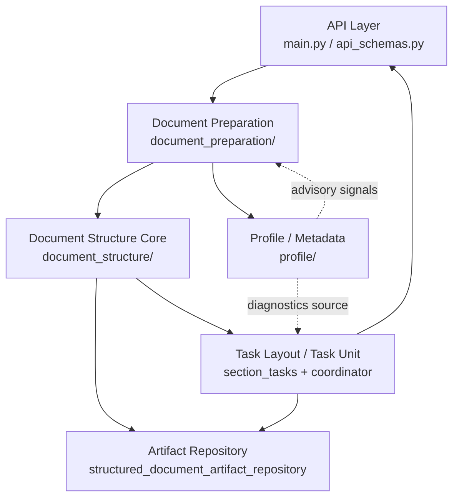

# Deep Reflective Reader High-Level Design

## Learning application module extraction (2026-11-10)

Maintainer-approved option A: extract the four app learning orchestration files
into sibling `learning/`, with [owned design](learning/module-detailed-design.md)
and [checklist](learning/module-checklist.md). Extraction and 299 local regression tests are complete; external review and deployment remain pending.
Generation/policy remain in section_tasks, persistence in document_structure/db,
preferences in reading_preferences, composition in config and transport in main/API
schemas. Ordinary translation continues sharing the same runtime and aligned data.
This is a package/ownership migration, not a new translation pipeline or DB migration.


## Shared translation direction (2026-11-09)

Maintainer-authorized correction: ordinary and language-learning translation share
one source-bound, sentence-aligned result and generation pipeline. Ordinary UI
continues showing an aggregate paragraph; learning UI keeps sentence pairs. Exact
language pairs/source versions govern reuse, independently of proficiency. Legacy
paragraph-only records remain readable but cannot supply fabricated sentence maps.
The [current contract](section_tasks/module-detailed-design.md#shared-sentence-translation-across-reading-modes-2026-11-09)
supersedes earlier statements that ordinary translation uses an independent generator
and artifact store. Historical acceptance evidence is retained.

The optimization removes duplicate translation generation across compatible modes
and avoids storing a separate aggregate for new aligned results; vocabulary and
legacy paragraph conversion remain separate costs. The
[reuse conditions and manual acceptance](section_tasks/module-detailed-design.md#reuse-and-storage-rationale-2026-11-10)
record the 2026-11-10 learning-to-normal verification and its evidence limits.


## Language Learning Architecture Plan (2026-10-28)

**[System scope complete: LLRN-01–22, 2026-10-29]** 新 per-book mode 遵循原有 hierarchy truth 與 explicit-write 邊界；句子定位屬 content block 內部，並非新 hierarchy 層。此規劃擴展 reading interactions，不更換 parser authority 或普通翻譯契約。

2026-10-29 maintainer 將 LLRN-22 收斂為系統驗收，22 項系統任務完成。記錄／重播工具保留 provider 原始文字，由正式驗證器判定 invalid output；不把已返回的格式錯誤誤作 unknown，不自動重送。765 項 backend 回歸及兩種報告格式的 SQL/1280/390 Reader 重播見 [scripts evidence](scripts/module-detailed-design.md#llrn-22-system-acceptance-scope-2026-10-29)。下述語義抽查是歷史觀察，模型品質不屬目前完成條件；該隔離驗收未執行 production migration/deployment；其後本機缺表問題已依 [DB 部署補正](db/module-detailed-design.md#local-reading-mode-schema-deployment-correction-2026-10-29) 明確補套 004/005。

新增 `reading_preferences` 為 domain owner：集中單人 workspace 母語與每書 mode/source override/proficiency；LLRN-02 已交付 Python contracts/catalog/port/file adapter，db 已完成 LLRN-07 preference SQL/顯式 migration，LLRN-09 已交付有效設定 service，LLRN-15 已組裝 runtime dependencies，LLRN-16 已提供 API/lifespan，LLRN-17 已提供 settings UI、LLRN-18 已提供當頁 controller；LLRN-19 已提供逐句呈現，user system 仍未交付。`language` 管 codes/proficiency definitions；`shared` 管純資料契約；`section_tasks` 管切句、對齊生成、提示與 cache/admission 規則；`document_structure` 管 hierarchy-aware repository/file adapter 和來源失效；`db` 管偏好/學習資料 SQL 與顯式 migrations。`learning` 獨立承擔學習 application orchestration、worker 與通知；`app` 保留一般閱讀協調與普通翻譯 adapter，並共用 learning runtime；`api_schemas.py`/`main.py` 管 transport；`config` 組裝；UI 僅呈現權威投影與使用者選用模式後的當頁明確命令。

模式擴充採 reading_preferences 擁有的 stable-ID catalog 與分模式 typed/versioned settings；book 僅一個 active mode。UI 共用模式 list/detail shell 與 reader 組裝，各模式 feature 自持設定、action 與 request lifecycle；後端不下發可執行 UI，本期不建立動態插件平台。選取候選與保存啟用分開，mode/settings 一次原子套用。

生成前 durable claim 防止併發重複付費，provider 在 DB 交易外；提交時驗證 source/settings/fencing，output/receipt 同交易。Cache 按來源、語言、切句/規則版本區分，提示再含 scheme/level；改能力不重譯。原文/OCR 套用修正、Undo/reparse/deletion 與全等級失效在同一來源 mutation 邊界處理，普通 reads 不生成或清理資料。

[Canonical design](section_tasks/module-detailed-design.md#language-learning-reading-mode-plan-2026-10-28) 與 [task DAG](section_tasks/module-checklist.md#language-learning-reading-mode-queue-2026-10-28) 是實作依據；已交付 LLRN-01 language proficiency definitions/validation、LLRN-02 偏好基礎、LLRN-03 共用來源/句子/譯文/提示 DTO、LLRN-04 規則式多語切句、LLRN-05 cache/admission/operation 純策略、LLRN-06 learning repository/file adapter 、LLRN-07 preference SQL/migration 、LLRN-08 learning SQL/migration 、LLRN-09 有效偏好服務、LLRN-10 逐句翻譯生成、LLRN-11 能力提示生成、LLRN-12 來源／文件生命週期、LLRN-13 application orchestration/admission 、LLRN-14 transport schemas/pure projections 、LLRN-15 dependency composition 、LLRN-16 routes/lifespan 、LLRN-17 settings UI 、LLRN-18 current-page controller 及 LLRN-19 sentence-pair display。LLRN-05 固定分離 key、claim/dispatch/checkpoint/commit 的條件轉移、unknown recovery、lease/fence 與明確重試；純策略測試之外，LLRN-06 已以 preferences → document → learning 鎖序及單一 sidecar replace 實作 file durable claim/receipt/checkpoint/output，並有多程序、故障/重啟證據；LLRN-08 已補齊 SQL 持久化，application orchestration 已由 LLRN-13 交付，runtime DI 已由 LLRN-15 交付。Learning claim/commit 不修改來源與偏好；LLRN-12 lifecycle 另以 SQL 同交易或 file journal 協調，不宣稱跨檔案瞬間原子性。Section_tasks 的切句器消費 language 集中的 prefix rules 與 shared source binding，保留全文/code-point spans；無標點或不確定句界保守合併，不依字數硬切、不新增模型請求。Shared 只做純資料結構與來源 reference 驗證；不提供切句、生成或儲存，source ownership 已由 LLRN-06 repository 解出，完整 epoch lifecycle/binding 作廢已由 LLRN-12 接入來源寫入。偏好 file adapter 以 workspace lock、CAS 與 atomic replace 保存 mode/settings，純讀不補寫；rename/delete 已由 LLRN-12 lifecycle port 協調，file 採 journal/顯式恢復，不宣稱跨檔案交易。LLRN-07 以 workspace/book 兩張表及同一短交易保存偏好：workspace row lock、CAS、bounded queries、原子 rename/delete 與 receipt；明確升降版，不在讀取時 DDL。真 SQL failure/concurrency/file parity 已驗證。LLRN-08 以五張 resource/key/operation 表保存 learning rows，共用 file/domain repository behavior；preferences → document → learning 同一短交易做 claim/commit，readonly MVCC 做 source/result reads，只載入請求 key 的必要歷史；checkpoint SQL 分頁。47 真 SQL tests 與實際 server restart 驗證通過。LLRN-09 以注入的既有 profile reader 與 override 解析有效來源，返回各 mode eligibility/原因；設定 CAS 沿用 file/SQL port，不呼叫模型或回寫 profile。64 項服務 file/真 SQL tests 及 82 項基礎回歸通過；LLRN-13 已在 source/settings 鎖內重驗有效 profile binding，但不宣稱獨立 profile 儲存的跨資源原子性。LLRN-10 已交付 provider-injected 段落逐句翻譯：以配置模型能力及離線 tokenizer 按需分批、嚴格對齊驗證、partial checkpoint payload 與完整結果組裝；一般段落一次請求。24 項專測、149 項回歸與兩本備份短段落真 provider/file 對齊及提交檢查通過（語義抽查仍有誤譯，品質未通過）；模型失敗不自動重送，backend dispatch ownership 已由 LLRN-13 接入。LLRN-11 提示服務直接依原文和 registry 能力描述生成，按級別分存、空結果可重用；source occurrence 由後端驗證定位，foreign/null 句子不得套分級，與 translation revisions/失敗獨立。29 項專測 + 169 項回歸通過；兩本備份各兩等級與混語控制的真 provider/file 定位保存檢查通過，但詞義、能力適配與混語判斷仍有錯誤，語義品質 gate 未通過。翻譯/提示共用配置模型能力和有界句子分批，無額外文字上限；兩者已接入 LLRN-13 durable application execution。LLRN-12 已在來源交易推進 epoch／全級別作廢，Undo/legacy save 不復活；rename 遷移學習 references 與偏好，delete 留 tombstone。File coordinator 有 journal 中斷恢復，SQL 同交易 rollback/concurrency 驗證；完整 runtime DI 已由 LLRN-15 交付。LLRN-13 的 backend worker 接受工作後獨立於 HTTP owner，逐 batch 在 admission／dispatch CAS acknowledgement 後呼叫模型；lost ack 停下回查，完整 checkpoints 可離線完成，不自動重送 unknown。81 項 file/真 SQL 專測、290 項回歸及兩本備份固定 provider 流程驗證通過。LLRN-14 已交付嚴格偏好／學習 DTO 及純 response projections，以 opaque source token、書籍綁定 operation handle 與獨立 saved/operation states 保持 authority 邊界；56 項契約專測、154 項底層回歸及五份既有 schema scripts 通過。LLRN-15 已組裝同一 file/SQL storage owners、lazy single-attempt provider、唯讀 source profile reader 與可 drain 的 resource；33 項專測（含真 SQL/SDK HTTP mock）及相關回歸通過。LLRN-16 已註冊 11 個 production routes、route-local safe errors/no-store 與唯一 runtime lifespan/drain；50 項 file/真 SQL HTTP 與 main/OpenAPI/lifecycle 專測及相關回歸通過。LLRN-17 已交付集中母語／每書 list/detail 設定 UI，1280/390 受控 API 及 temporary file-backed 實際 API 保存/reload 驗收通過，未呼叫模型；LLRN-18 已交付當頁 read-before-generate、獨立分項狀態、有界併發/輪詢與 session command recovery，14 組 controller 專測、1280/390 Actual App 及 temporary file-backed 真 API/固定 provider 驗收通過（兩個可見段落共 4 calls，reload 重用）。LLRN-19 已交付逐句原文/母語譯文、Insight 前詞語提示、分項刷新/確認重試及普通模式 session 恢復，1280/390 Actual App 與真 API/固定 provider 顯示驗收通過。LLRN-20 已以 738 項不同測試（14 新增跨模組流程、724 既有回歸）驗證 file/真 SQL/ASGI、設定與來源生命週期、unknown/replay/fencing；零 skips，隔離資源已清理。LLRN-21 已以 type/build、10 組 controller/browser suites、1280/390 traces/鍵盤/截圖及臨時 file/固定 provider 的實際 learning API 驗證；修正 settings 離開確認卸載 active panel 導致取消後步驟重置，無 backend contract 更動。LLRN-22 已交付真書／真模型/API/SQL/Reader 驗收工具：有限段落 8 次配置 provider 請求，兩級別 cache、重開與 reload 重用通過。語義抽查仍有角色／比喻誤讀、級別選詞與混語不穩定，品質 gate 未通過。UI 修正當前 saved 結果被歷史 completed operation 的舊設定版本誤標 stale；後續以捕捉的真回應重播驗證，無額外模型請求。詳見 scripts owner LLRN-22；未部署使用者資料庫 migration。

> 事實標註：
> - **[Code-Confirmed]**：已由目前 codebase 直接確認
> - **[From Proposal]**：來自 `proposal.md` 的整理描述
> - **[Needs Confirmation]**：目前資訊不足或需 maintainer 明確決策

## 1. Purpose of This Document

本文件用途是描述 Deep_Reflective_Reader 的高層技術設計，重點包含：

- 建立 module map
- 明確 module responsibility
- 描述主要 data flow
- 固定 hierarchy-first architecture
- 區分 implemented / planned / open questions

本文件不是產品簡介，也不是低層實作說明。**[Code-Confirmed]**

---

## 2. Design Scope

本文件覆蓋：

- high-level module architecture
- module responsibility
- module relationships
- primary data flow
- persistence boundary
- diagnostics boundary
- parser / profile / artifact / task-layout 關係

本文件不覆蓋：

- function-level implementation
- prompt wording details
- algorithm 細節
- database selection
- UI design
- deployment design
- performance tuning

**[Code-Confirmed]**

---

## 3. System Overview

目前系統可抽象為：

```text
Raw Document
  -> Document Preparation
  -> Parser Metadata
  -> Structured Hierarchy
  -> Post-Structure Metadata
  -> Task Layout
  -> Summary / Quiz / Artifacts
  -> Diagnostics / Recommendation
```

高層語義：

- Structured Hierarchy 是核心 contract。**[Code-Confirmed]**
- `chapters[].sections[].task_units[]` 是主 persistence source。**[Code-Confirmed]**
- task-layout 是 projection/read path。**[Code-Confirmed]**
- diagnostics 是 projection，不是 hidden mutation。**[Code-Confirmed]**
- metadata 是 advisory，不是 parser authority。**[Code-Confirmed]**

---

## 4. Core Design Principles

### 4.1 Hierarchy-first
- meaning：runtime 與主要資料模型優先使用 chapter/section hierarchy。
- why it matters：避免 flat mirror drift，讓 targeting/persistence 一致。
- affected modules：`document_structure/`, `section_tasks/`, `app/section_task_coordinator.py`。
- 標註：**[Code-Confirmed]**

### 4.2 Pure hierarchy persistence
- meaning：新輸出預設不再寫 root `sections[]` 與 `structure_nodes[]` mirror。
- why it matters：降低雙表示同步成本與資料重複。
- affected modules：`document_structure/structured_document.py`, repository。
- 標註：**[Code-Confirmed]**

### 4.3 Metadata as advisory
- meaning：`parser_metadata`/`post_structure_metadata` 提供提示與診斷，不直接主導 parser。
- why it matters：避免 LLM/profile 成為不可控 parser authority。
- affected modules：`profile/`, `document_preparation/`。
- 標註：**[Code-Confirmed]**

### 4.4 Diagnostics as projection
- meaning：diagnostics 由 persisted metadata + current layout state 組合投影。
- why it matters：診斷要反映當前讀取狀態，同時不造成隱性寫入。
- affected modules：`section_tasks/document_task_layout.py`, `app/section_task_coordinator.py`。
- 標註：**[Code-Confirmed]**

### 4.5 Explicit write paths only
- meaning：summary/quiz/task-layout metadata 透過明確 repository write path 更新。
- why it matters：避免 side effects 分散在 read path。
- affected modules：`document_structure/structured_document_artifact_repository.py`, coordinator。
- 標註：**[Code-Confirmed]**

### 4.6 LLM as helper, not authority
- meaning：LLM 用於 classification/generation，搭配 deterministic 機制與 fallback。
- why it matters：提高穩定性、可回歸性。
- affected modules：`profile/document_profile_builder.py`, `profile/parser_metadata_extractor.py`, section task services。
- 標註：**[Code-Confirmed]**

### 4.7 Backward compatibility without new legacy writes
- meaning：保留舊 JSON 可讀，不再預設產生新 legacy mirror。
- why it matters：遷移過程可持續，但不再擴大技術債。
- affected modules：`structured_document.py`, repository load/migration path。
- 標註：**[Code-Confirmed]**

### 4.8 Parser strategy evolves gradually
- meaning：先有 recommendation/diagnostics，再決策是否導入自動策略切換。
- why it matters：降低 parser 行為突變風險。
- affected modules：`enhanced_parse_trigger_evaluator.py`, coordinator, API。
- 標註：**[Code-Confirmed]** + **[Needs Confirmation]**（是否進 auto-switch）

### 4.9 Parser metadata cache-first usage (common parser)
- meaning：`DocumentProfile.parser_metadata` 可作為 common parser 的快取輔助訊號；在 `force_rebuild=false` 且 source hash 未變時，優先重用既有 common parser 結果。
- why it matters：減少重複計算，保留前一次 profile/LLM 分析上下文，為後續 enhanced parser 決策提供穩定背景。
- affected modules：`document_preparation/`, `profile/`, `document_structure/`（策略層）。
- finalized cache contract（目前決策）：
  - cache key 建議至少包含：`doc_name + raw_text_hash + common_parser_version + structure_schema_version`
  - invalidation 條件：`force_rebuild=true`、`raw_text_hash changed`、`common_parser_version changed`、`structure_schema_version changed`、cache missing/corrupted
  - 欄位命名策略：先在設計文件採語義化標準命名；實作命名遷移延後至後期維護階段
  - 可觀測性策略：保留 cache invalidation reason code（先可內部可觀測，後續再 API 契約化）
  - `parser_metadata` 不作為 common parser 規則控制因子，只可用於省算與輔助其他模組，避免循環依賴
- 標註：**[From Proposal]**（maintainer policy accepted）

### 4.10 Two-layer normalized hierarchy as current scope
- meaning：目前高層結構固定為 `chapter -> section`；不在本期引入 `Part -> Chapter` 持久化層級。
- why it matters：聚焦普遍文檔型態，避免為少數多層案例提前擴大 schema 複雜度。
- affected modules：`document_structure/`, `section_tasks/`, `profile/`（主要是 contract 與 metadata 表達）。
- 標註：**[From Proposal]**（maintainer policy accepted）

---

## 5. High-Level Module Map

### 5.1 API Layer
- 模組：`main.py`, `api_schemas.py`
- 責任：暴露 preparation、task-layout、summary/quiz、reparse 等 endpoint。
- 邊界：不承擔核心解析/持久化邏輯。
- 標註：**[Code-Confirmed]**

### 5.2 Configuration / Dependency Assembly
- 模組：`config/`（特別是 `config/container.py`, `config/app_DI_config.py`）
- 責任：組裝 providers/services/repositories，集中 runtime config。
- 標註：**[Code-Confirmed]**

### 5.3 Document Preparation Layer
- 模組：`document_preparation/`
- 責任：raw loading、language detection、profile build、structured build、FAISS、bundle。
- 特點：已包含 post-structure enrichment step。
- 標註：**[Code-Confirmed]**

### 5.4 Document Structure Core
- 模組：`document_structure/`
- 責任：hierarchy contract、split/build、hierarchy index、artifact repository、enhanced parse evaluator。
- 標註：**[Code-Confirmed]**

### 5.5 Profile / Metadata Layer
- 模組：`profile/`
- 責任：`DocumentProfile`、`parser_metadata`、`post_structure_metadata`、evidence/classification。
- 邊界：metadata 為 advisory 訊號來源。
- 標註：**[Code-Confirmed]**

### 5.6 Task Layout / Task Unit Layer
- 模組：`section_tasks/` + `app/section_task_coordinator.py`
- 責任：task-layout projection、task unit resolution、artifact availability/cache validity、summary/quiz orchestration。
- 標註：**[Code-Confirmed]**

### 5.7 Prompt / LLM Interaction Layer
- 模組：`prompts/`（`prompt_assembler.py`）與各 task prompt builder（在 `section_tasks/`）
- 責任：組裝 prompt、注入 profile/context。
- 邊界：不應成為 parser authority。
- 標註：**[Code-Confirmed]**

### 5.8 Shared Utilities
- 模組：`shared/`
- 責任：跨模組資料結構（`TaskUnit`, `TaskArtifacts`, `DocumentTaskArtifacts`）
- 標註：**[Code-Confirmed]**

### 5.9 Tests
- 現況：專案主要是 `scripts/test_*.py`；未看到 `tests/` 目錄。
- 責任：regression、hierarchy purity、artifact persistence、diagnostics 行為驗證。
- 標註：**[Code-Confirmed]**

---

## 6. Module Relationship Diagram



說明：
- 實線：主要 read/write 依賴。
- 虛線：advisory/diagnostics 依賴，不是 parser 強制控制。
- 標註：**[Code-Confirmed]**

---

## 7. Primary Data Flow

### 7.1 Preparation Flow
- Raw document 載入後，先做 language detection 與 profile。
- 接著建 structured hierarchy，再做 post-structure enrichment。
- common parser 結果在 cache 可用（且未 force rebuild / hash 未變）時可重用，避免重算。
- 標註：**[Code-Confirmed]**（pipeline 順序）+ **[From Proposal]**（cache-first policy 已定案）

### 7.2 Task Layout Flow
- 由 structured document 讀取有效 hierarchy sections，組成 chapters-first layout projection。
- 標註：**[Code-Confirmed]**

### 7.3 Artifact Write Flow
- section/chapter summary/quiz 與 task-layout metadata 透過 repository 更新 hierarchy 節點。
- 標註：**[Code-Confirmed]**

### 7.4 Diagnostics Flow
- persisted profile metadata + current layout section state，形成 `profile_diagnostics`。
- 不回寫 profile store。
- 標註：**[Code-Confirmed]**

### 7.5 Enhanced Parser Recommendation Flow
- 由 evaluator 產生 score/reasons/metrics，於 task-layout response 暴露 recommendation。
- 目前預期流程是「提示用戶分數與理由，由用戶手動觸發 reparse」，不做自動 rerun。
- 標註：**[Code-Confirmed]**（recommendation exists）+ **[From Proposal]**（manual reparse policy 已定案）

### 7.6 Document shape normalization flow (current policy)
- flat 長文：可走 llm parser 拆成多章，chapter 名稱可由 LLM 產生。**[From Proposal]**
- flat 短文：若只足夠單一 task unit（或語義不足以分章），固定單章。**[From Proposal]**
- chapter-only 文檔：尊重章級結構；每個 chapter 保持唯一 section（同名、不同 id）。**[From Proposal]**
- 標準文檔：先 common，結果不佳再由 recommendation 引導手動 llm reparse。**[From Proposal]**
- 多層細碎文檔：仍收斂為 chapter-section；更細層級語意化為 task units，並把層級線索記錄於 metadata。**[From Proposal]**

---

## 8. Persistence Boundary

### 8.1 Persisted data
- Source of truth：`chapters[].sections[].task_units[]`。
- profile artifact：`topic/summary/document_language/parser_metadata/post_structure_metadata`。
- 標註：**[Code-Confirmed]**

### 8.2 Runtime projection
- `DocumentTaskLayoutResponse` 與 `profile_diagnostics` 是 read projection。
- 標註：**[Code-Confirmed]**

### 8.3 Legacy compatibility
- root `sections[]`、`structure_nodes` 可讀取，但非新 persistence 預設輸出。
- 標註：**[Code-Confirmed]**

### 8.4 Future candidate data
- parser hints 正式進入 parser strategy。
- 標註：**[Needs Confirmation]**

---

## 9. Parser / Profile / Diagnostics Boundary

Parser：
- 建立 structured hierarchy（chapters/sections）。**[Code-Confirmed]**
- 不應被 metadata 直接硬控制。**[Code-Confirmed]**
- 目前 `parser_metadata` 對 common parser 的角色是 cache/省算輔助，不是切分規則約束。**[From Proposal]**（maintainer policy accepted）

Profile：
- 保存 pre-structure `parser_metadata` 與 post-structure snapshot。**[Code-Confirmed]**
- 支援 recommendation/diagnostics 的觀測素材。**[Code-Confirmed]**

Diagnostics：
- 在 task-layout runtime 生成的 projection。**[Code-Confirmed]**
- 可能混合 persisted metadata 與 current layout state。**[Code-Confirmed]**
- 不應自動回寫 profile。**[Code-Confirmed]**

**metadata is advisory, not authority.**

---

## 10. Implemented vs Planned Capabilities

| Capability | Status | Evidence / Module | Notes |
|---|---|---|---|
| hierarchy-first StructuredDocument | Implemented | `document_structure/structured_document.py` | chapters 為 primary source |
| hierarchy-only artifact persistence | Implemented | `document_structure/structured_document_artifact_repository.py` | load-time migration + hierarchy write |
| task-layout hierarchy projection | Implemented | `app/section_task_coordinator.py`, `main.py`, `api_schemas.py` | chapters-first public response |
| section summary persistence | Implemented | coordinator + repository | hierarchy section artifacts |
| section quiz persistence | Implemented | coordinator + repository | hierarchy section artifacts |
| task-unit artifact persistence | Implemented | coordinator + repository | task unit artifacts under hierarchy |
| chapter summary / quiz support | Implemented | `main.py`, `api_schemas.py`, coordinator | chapter_id 優先 targeting |
| parser_metadata extraction | Implemented | `profile/parser_metadata_extractor.py` | deterministic + merge classification |
| post_structure_metadata enrichment | Implemented | `profile/post_structure_metadata_enricher.py`, pipeline | Step 4.5 |
| diagnostics projection | Implemented | `section_tasks/document_task_layout.py`, coordinator | mixed-source, read-only projection |
| enhanced parse recommendation | Implemented | `document_structure/enhanced_parse_trigger_evaluator.py` | score/reasons/metrics |
| parser metadata guided parsing | Partially Implemented | pipeline TODO + maintainer policy | 已定案「僅 cache/省算輔助，不約束 common parser 規則」；完整接線仍待實作 |
| auto parser switching | Planned | recommendation exists only | 現階段 policy 固定為「提示 + 使用者手動重觸發」 |
| Part -> Chapter nested hierarchy | Not Planned (Current Scope) | maintainer policy | 目前明確放棄 Part->Chapter persistence-level schema |

---

## 11. Current Architectural Risks

1. metadata 被誤用為 parser hard rule
- why risky：可能造成不可預期 parse 漂移。
- affected modules：`profile/`, `document_preparation/`, `document_structure/`。
- guardrail：維持 advisory contract + 測試限制 parser consumption。

2. diagnostics 被誤寫回 profile
- why risky：read path 產生 hidden mutation，造成觀測污染。
- affected modules：coordinator、profile store。
- guardrail：固定「task-layout 不寫 profile」測試。

3. task-layout read path 回滲 legacy fallback
- why risky：破壞 hierarchy-only runtime 假設。
- affected modules：coordinator、hierarchy index。
- guardrail：對 `document.sections` fallback 設 fail-fast regression。

4. legacy mirror 被重新引入新寫入
- why risky：再度出現雙表示同步問題。
- affected modules：structured model serialization、repository。
- guardrail：to_dict 預設輸出契約測試。

5. LLM enhanced recommendation 與 parser 切換責任不清
- why risky：若策略未落地到一致 contract / 測試，後續仍可能出現隱性 auto-switch 或策略分歧。
- affected modules：evaluator、coordinator、API。
- guardrail：先 formalize decision contract，再談自動化。

6. 多層文檔語義若未妥善下沉到 metadata / task units
- why risky：會把少數多層案例誤導成錯誤章節語義，影響 recommendation 與 target safety。
- affected modules：parser、profile、task-layout diagnostics。
- guardrail：固定兩層模型前提下，強化「層級線索進 metadata」與回歸測試。

7. artifact persistence 與 hierarchy contract 漂移
- why risky：artifact visibility、cache validity 會失真。
- affected modules：repository、task-layout projection。
- guardrail：section/chapter/task-unit visibility 回歸測試持續化。

8. module 邊界增長後的耦合風險
- why risky：coordinator 過重時容易承擔過多策略責任。
- affected modules：`app/section_task_coordinator.py`。
- guardrail：維持 high-level contract，避免低層邏輯跨層擴散。

---

## 12. Open Questions for Maintainer

1. 本 high-level-design.md 主要讀者是 maintainer 本人、協作者，還是未來開源讀者？
2. 是否要把「兩層模型（chapter-section）且 Part->Chapter 非本期目標」提升到對外文件（README/API docs）的正式 non-goals？
3. （已決策）cache key 命名先在設計文件標準化，實作命名遷移延後到後期維護。
4. （已決策）保留 cache invalidation reason code 能力；API 契約化時機待排程。
5. `profile_diagnostics` 是否需要正式文件化為 API contract？
6. `proposal.md` 中 maintainer-provided 實測結論，哪些需要再補 code-confirmed 或可重現 smoke 證據？
7. 下一版是否需要加入 sequence diagrams（prepare / task-layout / artifact write）？
8. 是否要在本文件加入 module ownership / boundary ownership（誰負責哪層）？
9. 是否要加 non-goals 區塊，避免 parser/profile/diagnostics 職責重新混淆？
10. 是否要加 migration history（dual representation -> pure hierarchy）章節？
11. `find_*_effective(...allow_legacy_fallback)` 的退場時間點是否現在就定義？
12. 是否要把 recommendation 與 diagnostics 區分為兩份對外文件（產品語義 vs 技術語義）？

---

## 13. Next Revision Plan

下一輪建議補完路徑：

1. 先收斂 maintainer 對 Open Questions 的回答。
2. 確認 ambiguous module 邊界（特別是 parser strategy 與 diagnostics contract）。
3. 精修 module relationship（必要時加 1~2 個 sequence diagram）。
4. 若 maintainer同意，新增 roadmap section（僅 high-level milestone）。
5. 若 maintainer同意，補 API contract section（特別是 diagnostics/ recommendation）。
6. 若 maintainer同意，補 migration history 與 non-goals。
7. README 與對外說明文件延後到後期維護階段，不作為本輪交付範圍。
